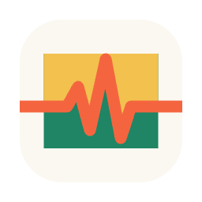

<p align="center"></p>

# Doctored

Fixing Pixels.

Doctored is a native macOS image editor for photographers: a Swift/AppKit app
over a Rust core that does the image work. It is free and open source. It was
formerly named Rasterize, and it still opens `.rz` documents.

## Download

Get the latest notarized build:
**[Doctored.dmg](https://github.com/kpgalligan/doctored/releases/latest/download/Doctored.dmg)**.
Every release, with its notes, is on the
[Releases](https://github.com/kpgalligan/doctored/releases) page.

Requirements:

- An Apple silicon Mac running macOS 15 Sequoia or later.
- 16 GB of RAM is the assumed minimum. Smaller Macs get a smaller working limit
  and may refuse large documents. Doctored ▸ Working Memory… changes the limit.

## What it does

- **Layers and masks**: groups, layer masks, vector masks and clipping masks,
  blend modes, layer styles, fill layers, layer comps, and text and shape layers
  that stay editable.
- **Adjustments and filters**: 22 adjustment-layer types (Levels, Curves,
  Hue/Saturation, Selective Color…), blur, sharpen and noise filters, Liquify,
  Lens Correction, and Neural Filters such as Depth Blur that run local models.
- **Selections**: marquees, lassos, the magic wand, quick and object selection,
  Color Range, Select Subject, Sky and people, Select and Mask for hair, Quick
  Mask, channels and paths.
- **Retouching and transforms**: healing, clone stamp, patch, the Remove tool,
  Content-Aware Fill and Move, dodge and burn, Sky Replacement, Free Transform,
  Warp and Puppet Warp; Generative Fill and Expand with your own cloud key.
- **Camera RAW**: a Develop dialog opens first, and a RAW layer can be
  re-developed later. CR3, CR2, NEF, ARW, DNG (including ProRAW), RAF and more.
- **Colour**: ICC profiles with soft proofing; Bitmap, Grayscale, Duotone,
  Indexed, RGB, CMYK and Lab modes; 8, 16 and 32-bit float; Merge to HDR.
- **Files in and out**: opens PSD and PSB with their layers, TIFF, PNG, JPEG,
  HEIC, WebP, AVIF, JPEG XL, OpenEXR and more, and rasterizes PDF and SVG.
  Save writes the native `.doctored` file.
- **Automation and safety**: recordable Actions, Batch, Merge Panorama, Load Files
  into Stack, Auto-Align and Auto-Blend; auto-recovery, History and snapshots.
- **Export and print**: the Export workspace and Quick Export, Export Layers,
  Contact Sheet, layered PSD, PSB or TIFF at 8, 16 or 32 bits, a one-page PDF,
  and Print.

The full [feature reference](public-docs/src/content/docs/reference/features.md)
covers every menu, tool, format and limit.

## AI assistant and agents

View ▸ Assistant (⌃⌘A) opens a chat assistant in the right panel that edits the
open document, renders the canvas to check its work, and makes each edit one
undo step. You bring your own Anthropic API key, entered in the panel's Chat
Settings… and stored only on your Mac.

External agents connect through the MCP helper bundled in the app. Settings ▸ MCP
copies the command that adds it to Claude Code:

```sh
claude mcp add --scope user doctored -- '/Applications/Doctored.app/Contents/Helpers/doctored-mcp'
```

An agent can open and render documents and work with layers, selections,
painting, filters, adjustments, colour, Actions and export; each edit is one
undo step and shows live in the open window. The helper starts Doctored in the
background when it is not running and talks to it over a private Unix socket;
nothing listens on the network. The
[MCP tool reference](public-docs/src/content/docs/reference/mcp-tools.md) lists
every tool and its arguments.

## Building from source

Prerequisites:

- Xcode 26
- Rust stable through [rustup](https://rustup.rs) (1.89 or later)
- [xcodegen](https://github.com/yonaskolb/XcodeGen) (`brew install xcodegen`)
- [Bun](https://bun.sh), which builds the assistant's helper
- Python 3, for the test and check scripts

The first build needs the network for the Rust crates and `bun install`.

```sh
make app-debug  # Debug build → build/Build/Products/Debug/Doctored.app
make run        # Release build, then launch it
make test       # the Rust core's test suite
make app        # Release build → build/Build/Products/Release/Doctored.app
```

Contributor commands and rules are in [CLAUDE.md](CLAUDE.md).

## Repository layout

| Directory | What it holds |
| :--- | :--- |
| `app/` | The Swift/AppKit app: sources, bridging header, resources, app icon |
| `core/` | The Rust staticlib that does the image work, its C header (`include/doctored_core.h`) and its tests |
| `agent/` | The assistant's helper (TypeScript, built with Bun) |
| `mcp-proxy/` | `doctored-mcp`, the stdio MCP helper bundled for external agents |
| `scripts/` | The gate, test runners, probes and app drives |
| `designs/` | Design decisions (ADRs) and the status docs of open work |
| `archive/` | Older design records |
| `public-docs/` | Astro/Starlight source for a docs site (not yet published) |
| `samples/` | Small generated test images |
| `.github/` | The release workflow |

## Contributing

Bugs and open work are tracked as
[GitHub issues](https://github.com/kpgalligan/doctored/issues). The development
rules, for people and coding agents alike, start at [CLAUDE.md](CLAUDE.md),
which imports the rules for each side (`core/`, `app/` and `mcp-proxy/`); the
docs site has its own `public-docs/CLAUDE.md`. Design decisions live in
`designs/` as ADRs, and older records in `archive/` (indexed in
`archive/INDEX.md`).

History before this repository's first commit, and the measurement harness
that wrote the Photoshop test fixtures under `core/tests/fixtures/`, are in the
private archive `kpgalligan/doctored-dev`. A fixture folder's README or
`photoshop.json` records the run that wrote it.

## Releases

Pushing to the `publish` branch builds, signs, notarizes and publishes
`Doctored.dmg` as a GitHub Release tagged `v<VERSION>.<run number>`
([`.github/workflows/publish.yml`](.github/workflows/publish.yml), whose header
lists the signing secrets). Local builds are ad-hoc signed.

## License

Copyright 2026 Kevin Galligan.

Doctored is licensed under the Apache License, Version 2.0; the full text is in
[`LICENSE`](LICENSE). Bundled third-party material keeps its own licence: the
fonts are OFL, the Lensfun lens database is CC BY-SA 3.0, and a downloadable
model shows its licence in Settings ▸ Models before it is downloaded.
<!-- readme-swept-to: 33af17a59c32f20c1b040ca1e13d1250da36e771 -->
